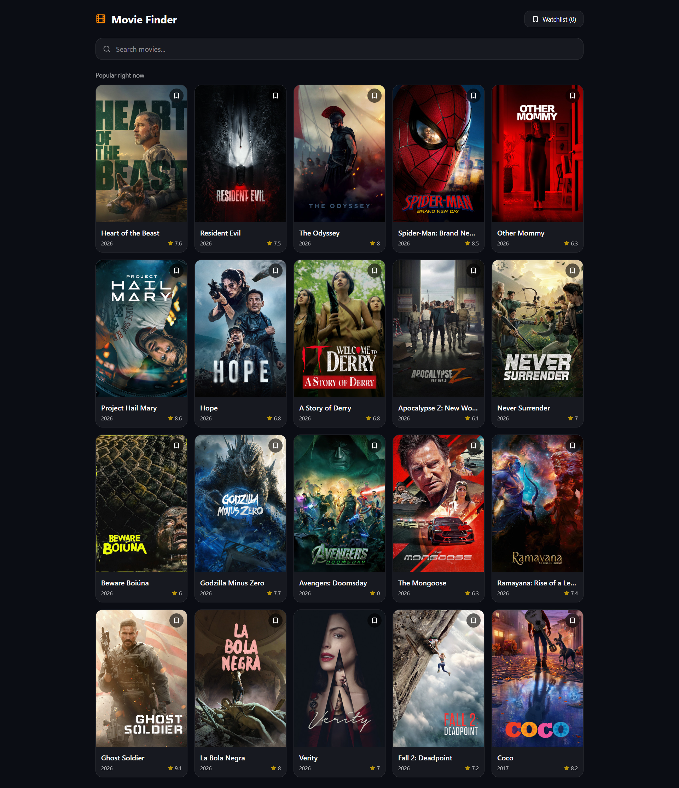

# Movie Finder

A full-stack movie discovery app. Search movies, browse what's popular, open detail pages, save movies to a watchlist and rate them from 1 to 5 stars.

**Live demo:** https://movie-finder-web-silk.vercel.app

(The API runs on a free Render plan, so the first request after a pause can take up to a minute.)

## Features

- Search movies and browse popular titles from TMDB
- Detail page with poster, genres, runtime, rating and overview
- Watchlist and personal 1-5 star ratings stored in MongoDB
- Each browser gets an anonymous ID, so every visitor sees their own watchlist
- Responsive layout

## Tech Stack

| Area | Tools |
| --- | --- |
| Frontend | React, Vite, React Router, Tailwind CSS, Lucide icons |
| Backend | Node.js, Express |
| Database | MongoDB Atlas with Mongoose |
| Data | TMDB API |
| Hosting | Vercel (frontend), Render (API) |
| Quality | GitHub Actions CI |

## How the secrets stay safe

The browser never talks to TMDB or MongoDB. It calls the Express API, which holds `TMDB_KEY` and `MONGO_URI` as environment variables on the server. The API only accepts browser requests from the configured `CLIENT_URL`.

## Getting Started

You need Node.js 20 or newer, a free [TMDB API key](https://www.themoviedb.org/settings/api) and a free [MongoDB Atlas](https://www.mongodb.com/cloud/atlas) cluster.

~~~bash
git clone https://github.com/abukitheunique/movie-finder.git
cd movie-finder
~~~

Server:

~~~bash
cd server
npm install
~~~

Create `server/.env` from `server/.env.example`, fill in your values, then run:

~~~bash
npm run dev
~~~

Client, in a second terminal:

~~~bash
cd client
npm install
npm run dev
~~~

Open http://localhost:5173. The Vite dev server proxies `/api` to the Express server on port 5000.

## Deployment

- **API (Render):** root directory `server`, build `npm install`, start `npm start`. Environment variables: `TMDB_KEY`, `MONGO_URI`, `CLIENT_URL`.
- **Frontend (Vercel):** root directory `client`. Environment variable: `VITE_API_URL` set to the Render API URL.

## API

| Method | Route | Description |
| --- | --- | --- |
| GET | `/api/movies/popular` | Popular movies |
| GET | `/api/movies/search?q=` | Search movies |
| GET | `/api/movies/:id` | Movie details |
| GET, POST | `/api/watchlist` | List or add watchlist items |
| PATCH, DELETE | `/api/watchlist/:movieId` | Rate or remove an item |

## Author

Built by [abukitheunique](https://github.com/abukitheunique).
